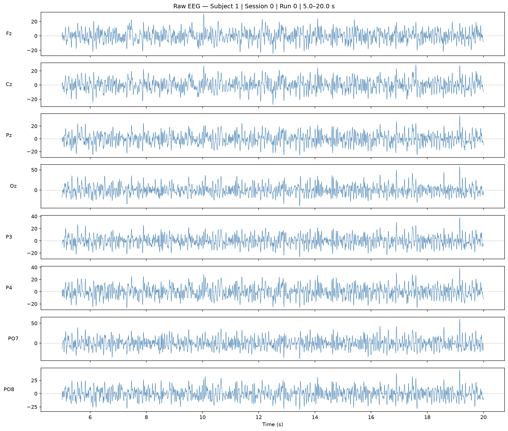

# BNCI2014-008 Dataset Inspection Summary

Generated: 2026-10-22

This report summarizes the subject, session, and run inspected by the notebook.

| Item | Inspection result |
|---|---|
| Dataset | BNCI2014-008 |
| Source | MOABB BNCI2014_008; DOI: 10.3389/fnhum.2013.00732 |
| Inspection date | 2026-10-22 |
| Subjects available | 8 |
| Subject inspected | 1 |
| Sessions for subject | 1 |
| Session inspected | 0 |
| Runs in session | 1 |
| Run inspected | 0 |
| EEG channels | Fz, Cz, Pz, Oz, P3, P4, PO7, PO8 |
| Sampling rate | 256.0 Hz |
| Recording duration | 1358.2 seconds |
| MNE EEG unit | Volts (V); multiply by 1e6 for µV display |
| Event IDs | {'NonTarget': 1, 'Target': 2} |
| Target events | 700 |
| NonTarget events | 3500 |
| Target:NonTarget ratio | 1:5.0 |
| Epoch shape | (4200, 10, 257) |
| Raw EEG plot | ../../figures/BNCI2014-008-Dataset-Inspection/raw_eeg_plot.png |

## Raw EEG figure

